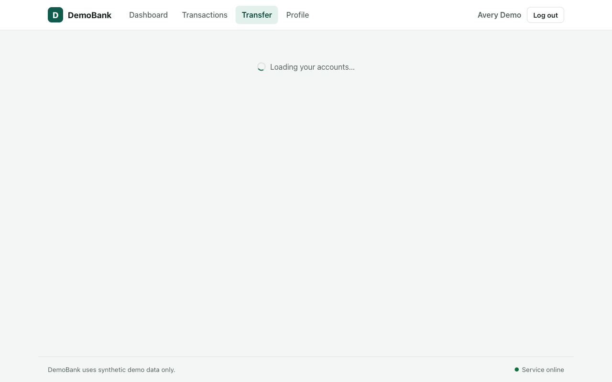
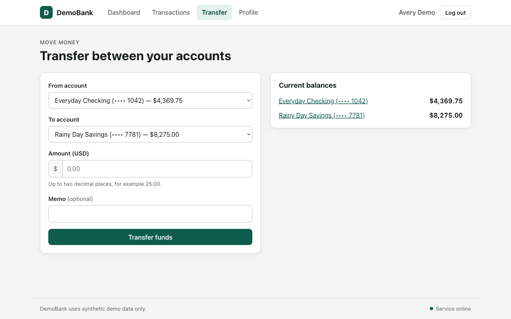

# DemoBank QA Audit Report

- **Target:** http://localhost:5173
- **Specification:** `../test-website/PRD.md`
- **Model:** gemini-3.8-flash
- **Run:** 2026-10-20 18:54 to 19:05 (10 min)

## Summary

22 requirements extracted from the PRD, 2 tested in the browser.

| Passed | Failed | Unverified |
|---|---|---|
| 1 | 0 | 21 |

## Requirement results

| ID | Section | Requirement | Verdict | Notes |
|---|---|---|---|---|
| REQ-01 | Users and access | The landing page displays an 'Enter Demo' button that opens the demo dashboard without requiring credentials. | **UNVERIFIED** | Not covered in this run (test budget or daily LLM quota). |
| REQ-02 | Users and access | The header identifies the active demo customer and provides a 'Log out' action that returns the user to the landing page. | **UNVERIFIED** | Not covered in this run (test budget or daily LLM quota). |
| REQ-03 | Users and access | Protected dashboard views are inaccessible after logging out, and direct navigation returns the user to the landing page or an access-required state. | **UNVERIFIED** | Not covered in this run (test budget or daily LLM quota). |
| REQ-04 | Users and access | Refreshing a protected page during an active demo session preserves the session, whereas refreshing after logout does not restore access. | **UNVERIFIED** | Not covered in this run (test budget or daily LLM quota). |
| REQ-05 | Dashboard and accounts | The dashboard displays checking and savings accounts with readable names, account types, masked identifiers, and balances formatted to two decimal places in USD without exposing full account numbers. | **UNVERIFIED** | Not covered in this run (test budget or daily LLM quota). |
| REQ-06 | Dashboard and accounts | Selecting an account navigates to its detail view showing the current balance and related transaction history matching latest successful transactions. | **UNVERIFIED** | Not covered in this run (test budget or daily LLM quota). |
| REQ-07 | Transfers between owned accounts | The transfer form provides fields for source account, destination account, amount, and an optional memo. | **PASSED** | Observed all four required controls: source account dropdown, destination account dropdown, amount input, and optional memo input on the transfer form. |
| REQ-08 | Transfers between owned accounts | Same-account transfers (source and destination identical) are rejected with a clear explanation, leaving balances and transaction history unchanged. | **UNVERIFIED** | Step budget (5) ran out before a verdict was reached. |
| REQ-09 | Transfers between owned accounts | Transfer amounts that are blank, zero, negative, non-numeric, or have more than two decimal places must be rejected with validation errors without altering balances or creating transactions. | **UNVERIFIED** | Not covered in this run (test budget or daily LLM quota). |
| REQ-10 | Transfers between owned accounts | Transfer amounts exceeding the source account's available balance must be rejected for insufficient funds, leaving balances unchanged and creating no transaction. | **UNVERIFIED** | Not covered in this run (test budget or daily LLM quota). |
| REQ-11 | Transfers between owned accounts | A valid transfer atomically decreases the source account balance and increases the destination account balance by the exact transfer amount. | **UNVERIFIED** | Not covered in this run (test budget or daily LLM quota). |
| REQ-12 | Transfers between owned accounts | A successful transfer creates one completed transfer record visible in both accounts' transaction histories with amount, date/time, source, destination, status, and memo. | **UNVERIFIED** | Not covered in this run (test budget or daily LLM quota). |
| REQ-13 | Transfers between owned accounts | Refreshing the browser after a successful transfer preserves updated account balances and the new transaction history record. | **UNVERIFIED** | Not covered in this run (test budget or daily LLM quota). |
| REQ-14 | Transfers between owned accounts | The UI reports transfer success only after commit and clearly explains any failure without showing false success states. | **UNVERIFIED** | Not covered in this run (test budget or daily LLM quota). |
| REQ-15 | Transaction history | Combined and account-specific transaction histories display date and time, description/memo, transaction type, amount with clear direction, status, and relevant account. | **UNVERIFIED** | Not covered in this run (test budget or daily LLM quota). |
| REQ-16 | Transaction history | Transaction history can be filtered simultaneously by account, transaction type, and status, with all displayed rows satisfying all active criteria. | **UNVERIFIED** | Not covered in this run (test budget or daily LLM quota). |
| REQ-17 | Transaction history | Date range filters are inclusive: transactions occurring on the exact start or end boundary dates must be included in the results. | **UNVERIFIED** | Not covered in this run (test budget or daily LLM quota). |
| REQ-18 | Transaction history | When filters produce an empty result set, the UI displays a clear empty state rather than an error or unrelated transactions. | **UNVERIFIED** | Not covered in this run (test budget or daily LLM quota). |
| REQ-19 | Transaction history | Clearing applied history filters restores the complete, unfiltered transaction history. | **UNVERIFIED** | Not covered in this run (test budget or daily LLM quota). |
| REQ-20 | Profile | The profile view displays only synthetic demo customer details (display name, masked email) and does not reveal passwords, authentication tokens, full account identifiers, or other users' data. | **UNVERIFIED** | Not covered in this run (test budget or daily LLM quota). |
| REQ-21 | General interface behavior | Interactive action submissions communicate loading/in-progress states to prevent accidental duplicate submissions. | **UNVERIFIED** | Not covered in this run (test budget or daily LLM quota). |
| REQ-22 | General interface behavior | Navigation controls and buttons lead to their labeled destinations, and recoverable errors provide options to retry or return to dashboard. | **UNVERIFIED** | Not covered in this run (test budget or daily LLM quota). |

## Test details and evidence

### REQ-08: UNVERIFIED

**Requirement:** Same-account transfers (source and destination identical) are rejected with a clear explanation, leaving balances and transaction history unchanged.

**Expected:** Transfer is rejected with a clear error indicating source and destination must differ. Checking balance remains unchanged ($B1 == $B2) and no new transaction is recorded ($T1 == $T2).

**Observed:** 

**Reason:** Step budget (5) ran out before a verdict was reached.

**Steps to reproduce:**

1. Open http://localhost:5173
2. Click "Enter Demo"
3. Wait for the page to update
4. Click "Transactions"
5. Wait for the page to update
6. Click "Transfer"

All step screenshots: [1](REQ-08/step_01.png) [2](REQ-08/step_02.png) [3](REQ-08/step_03.png) [4](REQ-08/step_04.png) [5](REQ-08/step_05.png)

### REQ-07: PASSED

**Requirement:** The transfer form provides fields for source account, destination account, amount, and an optional memo.

**Expected:** The transfer interface contains controls to select source account, destination account, enter an amount, and optionally enter a memo.

**Observed:** The transfer form at /transfer contains a source account select ('From account'), destination account select ('To account'), amount input ('Amount (USD)'), and memo input ('Memo (optional)').

**Reason:** Observed all four required controls: source account dropdown, destination account dropdown, amount input, and optional memo input on the transfer form.

**Steps to reproduce:**

1. Open http://localhost:5173
2. Click "Enter Demo"
3. Click "Transfer"

All step screenshots: [1](REQ-07/step_01.png) [2](REQ-07/step_02.png) [3](REQ-07/step_03_final.png)

## Cost breakdown

| Item | Value |
|---|---|
| Model | gemini-3.8-flash |
| LLM calls | 11 |
| Input tokens | 10,664 |
| Output tokens (incl. thinking) | 8,024 |
| Price used (per 1M tokens) | $0.75 in / $3.75 out |
| **Estimated cost at paid rates** | **$0.0381** |

This run used the Gemini free tier, so the actual charge was $0.00. The estimate shows what the same run would cost on the paid tier.
